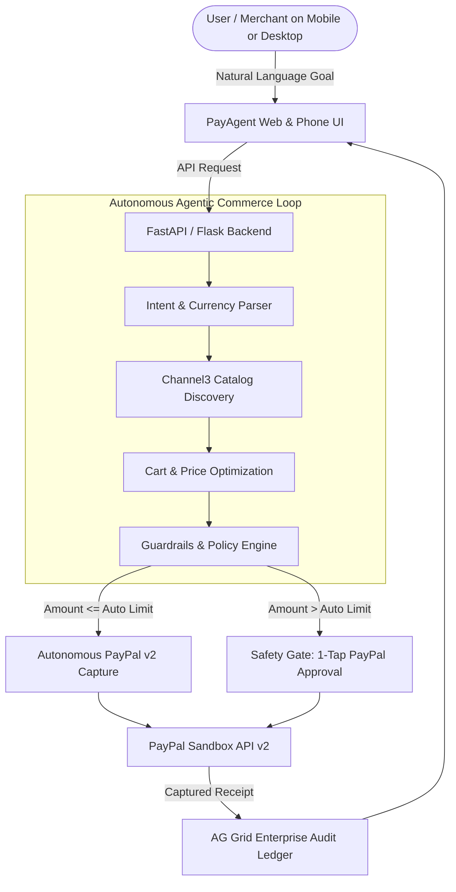

# PayAgent: Autonomous AI Commerce Engine with PayPal Guardrails

> **Built for the PayPal AI Hackathon 2026** (*"Build What's Next with PayPal and AI"*).  
> *Targeting:* **Best Overall ($12,000)**, **Best Use of Agentic Commerce ($5,000)**, **Best Use of PayPal + AI ($5,000)**, **AG Grid Bonus ($5,000)**, and **Render Deployment Bonus ($1,000)**.

[](https://developer.paypal.com/)
[](https://www.ag-grid.com/)
[](https://render.com/)
[](http://localhost:5173)

---

## 💡 What Is PayAgent in 3 Sentences?
1. **The Problem:** Everyone uses AI to research products, but you can't give an AI bot your credit card because it might hallucinate, get compromised, or overspend.
2. **The Solution:** **PayAgent** gives the AI a **guarded PayPal wallet** with hard rules: cheap items (e.g. < $60 or ₹5,000) are bought automatically with zero friction, while expensive items lock until you approve them with a 1-tap PayPal checkout button.
3. **The Result:** Complete peace of mind for autonomous e-commerce, with every decision and PayPal transaction ID recorded in an enterprise AG Grid ledger.

---

## 🌟 Key Features

* **🌍 Global Country & Currency Switcher:** Instant real-time conversion between 🇺🇸 USD ($), 🇮🇳 INR (₹), 🇪🇺 EUR (€), 🇬🇧 GBP (£), 🇨🇦 CAD (C$), and 🇯🇵 JPY (¥). All limits, catalog prices, and ledger receipts dynamically format to the chosen currency.
* **📱 Mobile-First Phone UI:** Fully responsive design with a dedicated **Phone View Toggle** and bottom navigation bar, making autonomous approvals as simple as mobile banking.
* **⚡ Dual-Tier Guardrail Governance:**
  * **Autonomous Mode:** Micro-purchases under threshold are evaluated, optimized, and captured automatically via PayPal Orders v2 Sandbox.
  * **Safety Gate:** High-value items exceed the autonomous threshold and trigger a human biometric / 1-tap PayPal sign-off.
  * **Hard Monthly Cap:** Prevents cumulative budget overruns.
* **📊 AG Grid Enterprise Ledger (Sponsor Award):** Real-time table displaying every transaction, PayPal Sandbox Order ID, category breakdown, quick-filter search, and one-click CSV export.
* **🛍️ Channel3 Product Catalog (Sponsor Award):** Clean 100M+ e-commerce product records (electronics, peripherals, office gear) accessed without web scraping.
* **🚀 Render-Ready (Sponsor Award):** Includes `render.yaml` blueprint and multi-stage `Dockerfile` for instant 1-click cloud deployment.

---

## 🏗️ Architecture



---

## 🚀 Quick Start Guide

### 1. Run with 1 Click (Windows)
Double-click `start.bat` in the root folder, or run:
```powershell
.\start.bat
```

### 2. Manual Start
* **Backend:**
  ```powershell
  cd backend
  python app.py
  ```
  *(API runs on `http://localhost:5000`)*

* **Frontend:**
  ```powershell
  cd frontend
  npm run dev
  ```
  *(UI opens on `http://localhost:5173`)*

---

## 🔬 Core Testing Scenarios & Interactive Walkthrough

* **Scenario 1: Global Currency Conversion**
  * Switch the country dropdown from 🇺🇸 USD ($) to 🇮🇳 INR (₹) or 🇪🇺 EUR (€).
  * Observe all budget thresholds, catalog prices, and transaction records recalculating in the selected currency in real time.

* **Scenario 2: Low-Value Autonomous Purchase**
  * Trigger: *"Procure 2 4K USB-C Braided Cables under $50"* (or equivalent in local currency).
  * Observe the agent's 5-step reasoning trace. Because the price is below the auto-buy cap, PayAgent automatically creates and captures the order in PayPal Sandbox v2, logging it with the `AUTO_APPROVED` badge in the AG Grid ledger.

* **Scenario 3: High-Value Safety Gate**
  * Trigger: *"Buy a Logitech MX Master 3S mouse"* or *"Procure a Herman Miller Aeron Chair"*.
  * Observe the safety gate engage. The transaction is safely held until the user clicks the PayPal checkout button to authorize the order.

* **Scenario 4: Budget Overrun Guardrail**
  * Trigger: *"Order 10 Thunderbolt 4 Docks with huge budget"*.
  * The agent detects that the order exceeds the monthly budget ceiling and automatically blocks the purchase to prevent financial loss.

---

## 📄 License
MIT License. Built for the **PayPal AI Hackathon 2026**.
